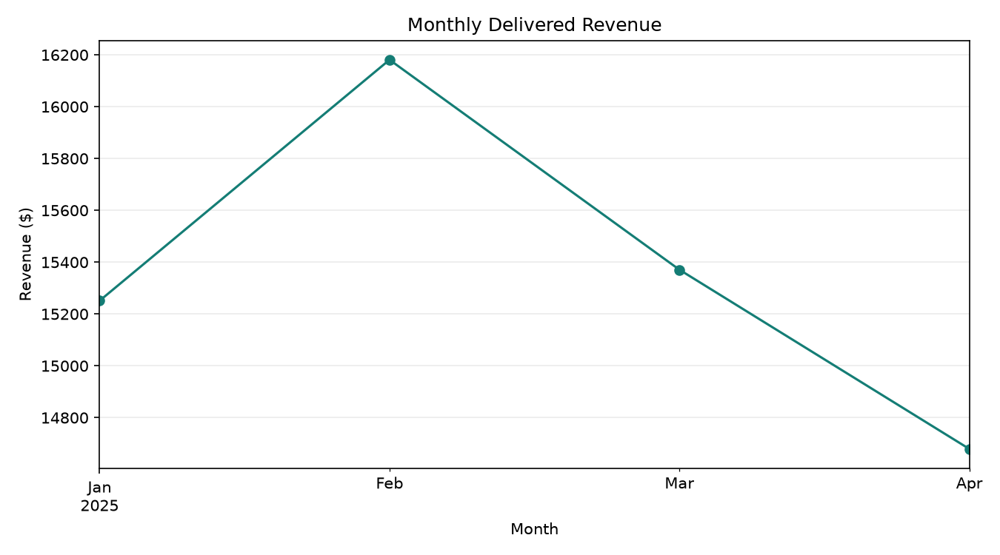
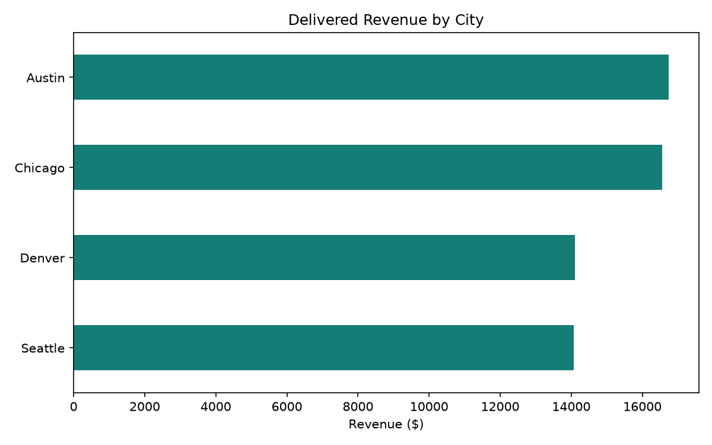
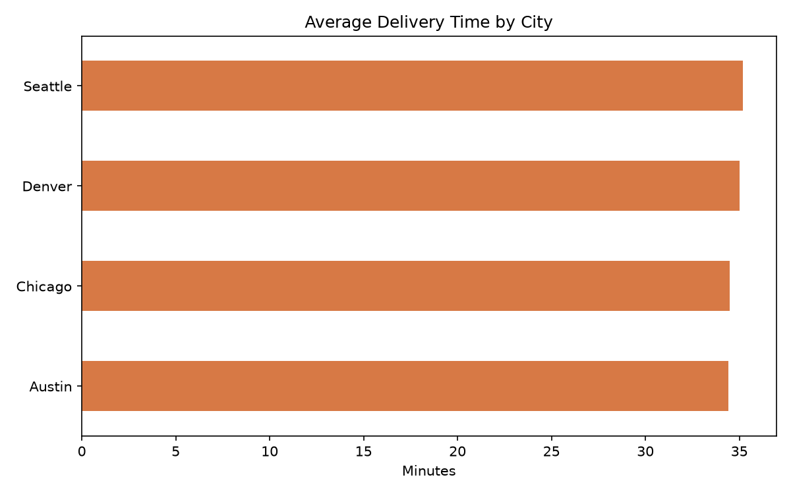
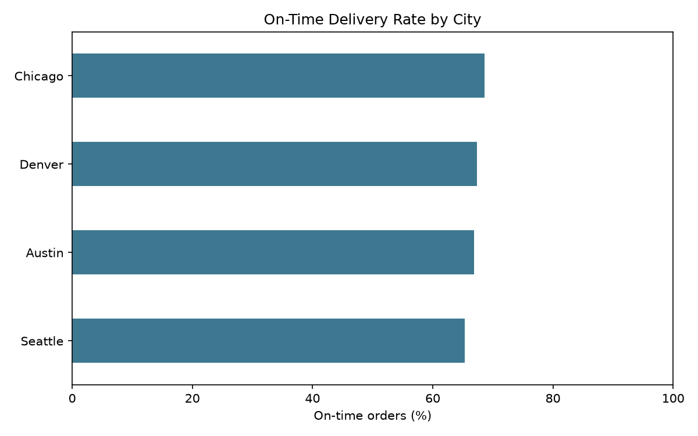

# Delivery Operations Analytics

A reproducible Python project exploring delivery revenue, fulfillment speed, on-time performance, and cancellations across four cities. It generates a deterministic sample dataset locally, so no external download or credentials are needed.

## Analysis Preview

### Delivered Revenue by Month



### City Performance







## Questions Answered

- How does delivered revenue change month to month and across cities?
- What percentage of placed orders are cancelled?
- Which cities have the fastest average delivery and the best on-time rate?

## Metric Definitions

- **Delivered revenue:** order value from delivered orders only; cancelled orders are excluded.
- **Cancellation rate:** cancelled orders divided by all placed orders.
- **Average delivery time:** mean delivery time for delivered orders only.
- **On-time rate:** delivered orders arriving within the promised time, divided by all delivered orders.

## Run Locally

From the repository root:

```bash
cd analytics_projects/delivery_operations
python -m pip install -r ../requirements.txt
python generate_data.py
python analyze_deliveries.py
```

The analysis saves four charts and `city_performance.csv` to `outputs/`. The city metrics CSV includes total orders, delivered orders, delivered revenue, cancellation rate, average delivery time, and on-time rate.

## Project Files

```text
delivery_operations/
|-- analyze_deliveries.py
|-- generate_data.py
|-- delivery_data.csv
|-- README.md
`-- outputs/
```

## Data and Limitations

The 1,500 sample orders are synthetic and generated with a fixed random seed for reproducibility. They demonstrate an analysis workflow; they do not represent a real delivery business and should not be used for operational decisions.